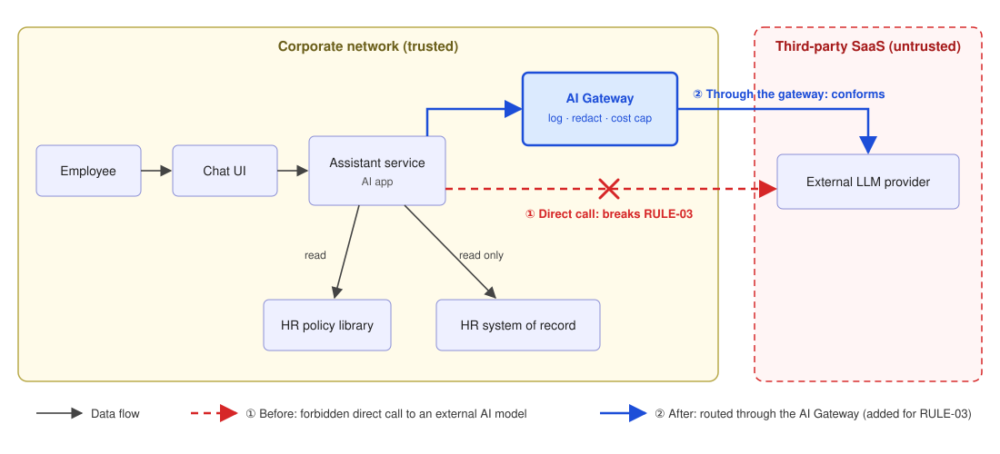

# SDD Architecture Demo — AI Gateway (VS Code)

A 10-minute, hands-on demo of **Specification-Driven Development (SDD) for architecture governance**. Architecture rules are written as executable checks, the architecture is a model in markdown, and a small script proves, on every change, that the design follows the rules and that every rule is traced to a requirement, a control, a task and evidence. For architects and engineers. Python only, no packages.

**Contents:** [The goal](#the-goal) · [How it works](#how-it-works) · [The scenario](#the-scenario) · [What it shows](#what-it-shows) · [Demo at a glance](#demo-at-a-glance) · [Setup](#setup-once) · [Terminal commands](#terminal-commands) · [Script](#script) · [Notes](#notes)

## The goal

Architecture standards usually live in documents and reviews. They drift: diagrams go stale, rules get bypassed, and "done" means someone said so. This demo shows a different approach:

- **Rules are executable.** Each rule in the constitution names a fitness function that tests the architecture model.
- **The model is the source of truth.** The diagram is generated from it, so it can't drift.
- **Every rule is traced end to end**: requirement → control at a real component → task → validation with evidence.
- **Humans decide, tools verify, AI accelerates.** AI can propose design changes and paperwork; only accountable people approve decisions and accept evidence.

## How it works

Four markdown files in `sdd/` are the source of truth:

| File | Holds | Owned by |
|---|---|---|
| `constitution.md` | Rules (RULE-##), each naming a check | Chief Architect (approves rules) |
| `spec.md` | Requirements (REQ), the architecture model (zones, components, flows), decisions (ADR), controls (CTRL) | Solution architect |
| `tasks.md` | Tasks (TASK) that implement each control | Delivery teams |
| `validation.md` | Validations (VAL) that prove each control, with evidence | Security / assurance |

Every rule must form a complete chain:

```
RULE-03 → REQ-003 → CTRL-003 @ ai-gateway (ADR-002) → TASK-003 → VAL-003
```

`python arch.py check` does three things:

1. **Traceability.** Every rule has a requirement, every requirement a control, every control a task and a validation; every reference points to something real.
2. **Conformance.** Each rule's fitness function runs against the architecture model (for example, "no flow to an external AI model unless it comes from a gateway").
3. **Diagram.** Regenerates `architecture-diagram.md` (Mermaid) from the model; violating flows are drawn red.

Each rule gets one status:

| Status | Meaning |
|---|---|
| ❌ Broken | The design breaks the rule, or the chain has a gap, or a task is Done without passing evidence |
| ⏳ Proposed | Design conforms and is traced, but a decision is Proposed, a task isn't done, or a validation hasn't run |
| ✅ Validated | Conformant, traced, decision accepted, task done, validation passed |

Overall: **FAIL** (any ❌), **CONFORMANT** (some ⏳), or **PASS** (all ✅). The check exits with code 1 on FAIL, so it can block a pull request in CI.

## The scenario

An **HR Policy Assistant** answers employees' HR policy questions using an external LLM. The starting architecture: two trust zones (corporate network, third-party SaaS), six components, five flows. Two rules are in force and fully validated: personal data never goes external (RULE-01), and AI is read-only on systems of record (RULE-02).

**The storyline:** Security and Finance require that every LLM call be logged, redacted and cost-capped. The Chief Architect adds **RULE-03: all external AI calls go through the enterprise AI Gateway**. The check immediately finds that the assistant calls the provider directly (flow F5). You then re-engineer the design, propagate the change through the spec, tasks and validation, and watch the status move ❌ → ⏳ → ✅.



## What it shows

> Companion to a first SDD demo that checks documents only; this one also checks the architecture model.

- Rules are tested by **fitness functions** that run against the architecture model.
- The **diagram is generated** from the model, so it can't drift from it.
- Traceability includes **decisions (ADR)** and **controls tied to real components**.
- The check catches **architecture drift** and **rule conflicts**.

## Demo at a glance

> **Before every run:** `python arch.py reset` (or Run Task → **SDD: Reset demo to start**). It puts `sdd/` back to the 2-rule starting state.

**Steps are file edits; commands only check, reset or load a finished copy.** You (or an AI assistant) edit the markdown files in `sdd/`, then run `check`. Commands run from the repo root as `python arch.py <command>` (or `Ctrl+Shift+B` for `check`); see [Terminal commands](#terminal-commands). The exact rows to paste are in the [Script](#script) below.

| Step | File (in `sdd/`) | You do | Command | You should see |
|---|---|---|---|---|
| 0. Prepare | — | Reset to the starting state | `reset` | ✅ PASS (2 rules) |
| 1. Baseline | `spec.md` | Walk the model: 2 zones, 6 components, 5 flows. Show one chain: RULE-02 → REQ-002 → CTRL-002 @ hr-system → TASK-002 → VAL-002 | `check` | ✅ PASS: 2 rules traced, validated, architecture conforms |
| 2. Trigger | — | Say: "Security and Finance want every LLM call logged, redacted and cost-capped" | — | — |
| 3. Add the rule | `constitution.md` | Paste the RULE-03 row under RULE-02 (Script step 3) | `check` | ❌ RULE-03: no requirement; F5 bypasses the gateway; F5 red in the diagram |
| 4. Re-engineer: **pick one route** (A, B or C) | | | | |
| 4A. With AI *(recommended)* | all four | Prompt Claude Code or Copilot (Script step 4A); it fixes the design and propagates. Review the diffs | `check` | Go to step 5 |
| 4B-1. By hand: fix the design | `spec.md` | Add the `ai-gateway` component; replace F5 with F5 + F6 through the gateway (Script step 4B) | `check` | ARCH ✅, but RULE-03 still ❌ (no requirement) |
| 4B-2. By hand: propagate | `spec.md`, `tasks.md`, `validation.md` | Paste REQ-003, ADR-002, CTRL-003 into `spec.md`; TASK-003 into `tasks.md`; VAL-003 into `validation.md` (Script step 4B) | `check` | Go to step 5 |
| 4C. Fallback | — | Load the finished version | `solution` | Go to step 5 |
| 5. Check again | — | Run the check | `check` | ⏳ CONFORMANT: ADR-002 Proposed, TASK-003 not started, validation not run |
| 6a. Board approves *(optional)* | `spec.md` | ADR-002 status → `Accepted` | `check` | ⏳ the ADR drops off the pending list |
| 6b. Build starts | `tasks.md` | TASK-003 status → `In progress` | `check` | ⏳ still pending |
| 6c. Try to cheat | `tasks.md` | TASK-003 status → `Done` | `check` | ❌ TASK-003 is marked Done, but its validation has not passed |
| 6d. Test passes | `validation.md` | VAL-003 Result → `Pass`, with date, reviewer and evidence path | `check` | ✅ PASS. To rerun step 6, run `solution` |
| 7. Drift *(optional)* | `spec.md` | Add F7 `assistant → llm-provider` after F6; check; then delete the row | `check` | ❌ F7 bypasses the gateway; red in the diagram |
| 8. Conflict *(optional)* | `spec.md` | Add F7 `assistant → hr-system`, personal, write; check; then delete the row | `check` | ❌ RULE-02: AI component writes to a system of record |
| 9. Close | — | Recap: rules are executable, the diagram is generated, every change is traced, humans approve | — | — |
| Afterwards | — | Back to the starting state | `reset` | ✅ PASS (2 rules) |

## Setup (once)

1. Install Python 3.8+ (no packages needed).
2. Open this folder in VS Code and install the recommended extension **Markdown Preview Mermaid Support** (VS Code prompts you).
3. Layout: `sdd/spec.md` and `sdd/constitution.md` on the left. On the right, open `architecture-diagram.md` and press `Ctrl+K V` for a live preview. The terminal goes at the bottom.
4. Optional: install Claude Code or GitHub Copilot for the AI step. Both read `CLAUDE.md` / `.github/copilot-instructions.md`.

**Run the check:** `Ctrl+Shift+B` (Mac: `Cmd+Shift+B`) or `python arch.py check`.
The check also regenerates the diagram, and the preview refreshes on its own.
**Before each rehearsal:** `python arch.py reset`, or Terminal → Run Task → **SDD: Reset demo to start**

```
sdd/constitution.md    rules + the check each one runs
sdd/spec.md            requirements, architecture model (zones, components,
                       flows), decisions (ADR), controls (@component)
sdd/tasks.md           tasks per control
sdd/validation.md      validations per control
architecture-diagram.md  GENERATED from the model
arch.py                checker: traceability + conformance + diagram
demo/start, demo/solution   reset copies and fallback
docs/*.png             before/after diagrams for your slides
docs/architecture-sketch.svg  architecture sketch shown in this README
```

## Terminal commands

Prefer the terminal (PowerShell, or the VS Code terminal) to VS Code tasks? Run these from the repo root. Use `python3` on Mac/Linux.

| Command | Same as VS Code task | What it does |
|---|---|---|
| `python arch.py check` | SDD: Check architecture (`Ctrl+Shift+B`) | Checks traceability and conformance; regenerates the diagram |
| `python arch.py reset` | SDD: Reset demo to start | Copies `demo/start` into `sdd/` (2 rules), then runs the check |
| `python arch.py solution` | SDD: Load finished solution (fallback) | Copies `demo/solution` into `sdd/` (RULE-03 done), then runs the check |

To discard all local edits using git instead: `git checkout -- sdd architecture-diagram.md`

## Script

### 1. Baseline (2 min)
Walk the architecture model in `spec.md`: two trust zones, six components, five flows. Each flow has a data classification and an access type.
Show one full chain: **RULE-02 → REQ-002 → CTRL-002 @ hr-system → TASK-002 → VAL-002**.
Press `Ctrl+Shift+B`.

> ✅ Both rules: traced, validated, and the architecture conforms (ARCH ✅). **PASS.**

**Say:** "The ARCH column isn't someone's opinion. A fitness function tested the model."

### 2. The trigger (30 sec)
> "Security and Finance want every LLM call logged, redacted and cost-capped. We have five AI apps calling providers directly."

### 3. Add the rule (1 min)
In `sdd/constitution.md`, add under RULE-02:

```
| RULE-03 | All calls to external AI models go through the enterprise AI Gateway. | Central logging, redaction, cost limits and provider switching | Chief Architect | external-ai-via-gateway |
```

Press `Ctrl+Shift+B`.

> ❌ RULE-03: no requirement, **and** `F5 assistant → llm-provider calls an external AI model without going through the AI gateway`.

Point at the diagram: **F5 is now red.**
**Say:** "The rule found a real design flaw, not a paperwork gap."

### 4. Re-engineer and propagate (3 min). Choose one.

**A. With AI (recommended).** In Claude Code or Copilot Chat:

```
I added RULE-03 to sdd/constitution.md. Make the architecture conform and propagate
the change through spec, tasks and validation, following CLAUDE.md. Then run python arch.py check.
```

Review the diffs. **Say:** "AI proposed the design change and the paperwork. ADR-002 is *Proposed*. The Review Board decides."

**B. By hand.**

`sdd/spec.md`, **Architecture model**: in **Components**, add:
```
| ai-gateway | AI Gateway | gateway | internal | Platform team |
```
In **Flows**, replace the F5 row with:
```
| F5 | assistant | ai-gateway | internal | invoke | HTTPS + workload identity |
| F6 | ai-gateway | llm-provider | internal | invoke | HTTPS, egress allow-list |
```
Press `Ctrl+Shift+B`. ARCH turns ✅ and the diagram shows the gateway, but the rule is still ❌ (no requirement).
**Say:** "Fixing the design isn't enough. The intent must be specified and verifiable."

`sdd/spec.md`: add one row each to **Requirements**, **Architecture decisions** and **Controls**:
```
| REQ-003 | The assistant calls AI models only through the AI Gateway, which logs every call and enforces a monthly cost limit. | RULE-03 | 100% of model calls in gateway logs; direct calls to the provider are blocked; calls over the limit are rejected |
```
```
| ADR-002 | Route model calls through the enterprise AI Gateway | One place for logging, redaction, cost limits and switching providers; adds one network hop | Direct provider SDK calls from each app (every app re-implements controls) | Proposed |
```
```
| CTRL-003 | Only the AI Gateway may reach AI provider endpoints (egress allow-list); the gateway logs each call and enforces the cost limit | REQ-003 | ai-gateway | ADR-002 |
```

`sdd/tasks.md`:
```
| TASK-003 | Point the assistant at the AI Gateway; add the provider to the gateway egress allow-list; block direct egress from the app subnet; set the cost limit | CTRL-003 | Platform team | ADR-002 approved | Not started |
```

`sdd/validation.md`:
```
| VAL-003 | CTRL-003 | Call the provider directly from the app subnet; send 50 test questions and reconcile with gateway logs | Direct call blocked; 50/50 calls logged | Not run | — | Security Architect | — |
```

**C. Emergency.** Run Task → **SDD: Load finished solution (fallback)**.

### 5. Check again (1 min)
Press `Ctrl+Shift+B`.

> ⏳ RULE-03 → REQ-003 → CTRL-003 → TASK-003 → VAL-003, ARCH ✅. **Proposed: ADR-002 is Proposed; TASK-003 not started; validation not run.**

**Say:** "Conformant by design. Not yet approved, built or proven. This is a design check, not a build. TASK-003 is the work order, CTRL-003 says what must be true, and VAL-003 says how we'll prove it."

### 6. Optional: the path to green (2 min)
Simulate what happens after the demo, in this order, pressing `Ctrl+Shift+B` after each step:

1. **Review Board approves.** In `spec.md`, set ADR-002 status to `Accepted`. → ⏳ the ADR drops off the list.
   Valid ADR statuses: `Proposed`, `Accepted`, `Superseded`, `Rejected`. Anything else (for example `Approved`) → ❌.
2. **Engineers build it.** In `tasks.md`, set TASK-003 to `In progress`. → still ⏳.
3. **Try to cheat.** Set TASK-003 to `Done`. → ❌ *TASK-003 is marked Done, but its validation has not passed.*
   **Say:** "You can't declare victory without evidence."
4. **The test runs.** In `validation.md`, set VAL-003 Result to `Pass`, with a date, reviewer and evidence path. → ✅ **PASS.**

To rerun step 6 from the ⏳ state: `python arch.py solution` (Run Task → **SDD: Load finished solution (fallback)**). When you're done, `python arch.py reset`.

### 7. Optional: architecture drift (1 min)
A team adds a "quick" direct call. In `spec.md` **Flows**, add after F6:
```
| F7 | assistant | llm-provider | internal | invoke | HTTPS |
```
`Ctrl+Shift+B` → ❌ F7 bypasses the gateway, and it shows red in the diagram. Delete the row afterwards.
**Say:** "In CI, this blocks the pull request before it ships."

### 8. Optional: a rule conflict (1 min)
Product asks for the assistant to submit leave requests. In **Flows**, add after F6:
```
| F7 | assistant | hr-system | personal | write | HTTPS |
```
`Ctrl+Shift+B` → ❌ RULE-02: AI component writes to a system of record. Delete the row afterwards.
**Say:** "This isn't a coding decision. It needs a constitution amendment or an approved exception, with an owner, compensating controls and an expiry."

### 9. Close (30 sec)
- Rules are executable: each one runs a fitness function against the model.
- The diagram is generated from the model, so it can't drift from it.
- Every design change is traced: decision, control at a real component, task and evidence.
- AI accelerates the engineering; humans approve ADRs and accept evidence.

## Notes

- Names, dates and results are illustrative demo data.
- Fitness functions live in `make_checks()` in `arch.py`. Add a check there before a rule can reference it. In practice, a platform team owns this library.
- The checker reads tables by column header. Keep the headers if you adapt the files.
